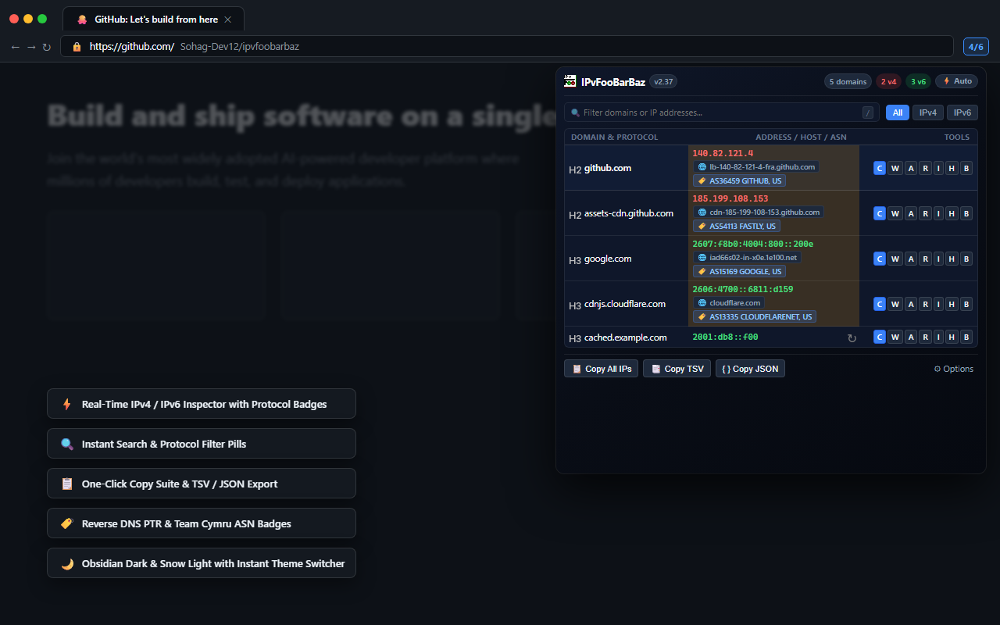
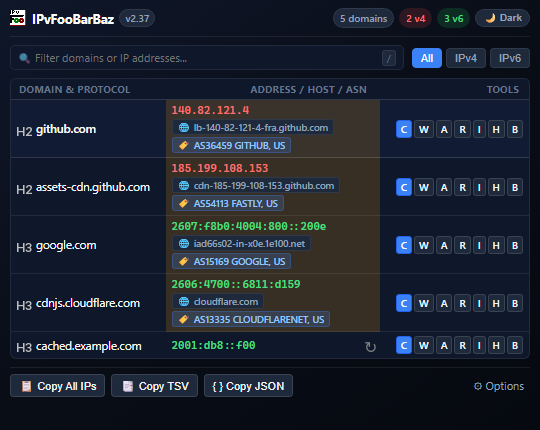
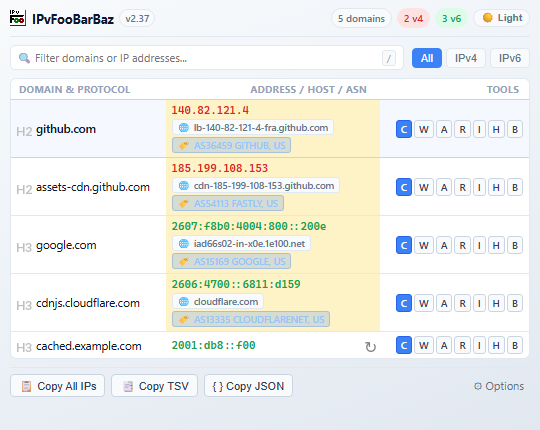
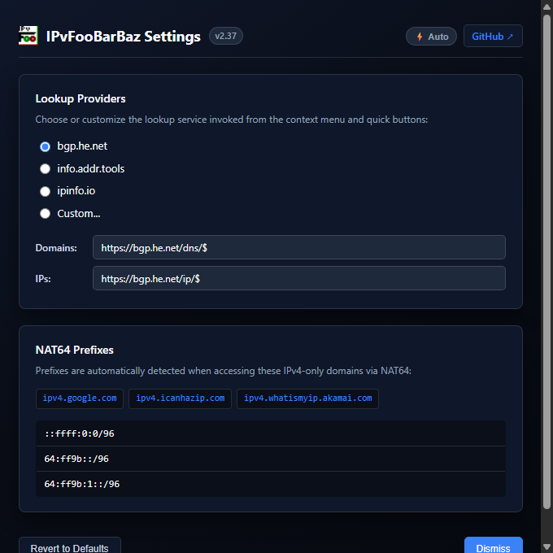

# IPvFooBarBaz

[](https://github.com/Sohag-Dev12/ipvfoobarbaz/blob/master/LICENSE)
[](https://github.com/Sohag-Dev12/ipvfoobarbaz/releases)
[](https://github.com/Sohag-Dev12/ipvfoobarbaz/raw/master/dist/ipvfoobarbaz-2.37.zip)

### 📦 Download Main Extension Package
👉 **[Download ipvfoobarbaz-2.37.zip (Direct Download)](https://github.com/Sohag-Dev12/ipvfoobarbaz/raw/master/dist/ipvfoobarbaz-2.37.zip)**  
*(Ready to upload directly to Chrome Web Store Developer Console or unzip and load unpacked in Chrome)*

**IPvFooBarBaz** is a lightweight, privacy-friendly Chrome and Firefox browser extension that indicates whether the current webpage was fetched using IPv4 or IPv6. Clicking the toolbar icon reveals an interactive popup listing every server IP address that served page elements, complete with PTR hostname, Autonomous System Number (ASN), and HTTP protocol version.

Everything is captured privately in real-time using the browser's `webRequest` API. Hostnames and ASNs are resolved via Google Public DNS and Team Cymru DNS services.

This is a fork of the original [IPvFoo](https://github.com/pmarks-net/ipvfoo) and [IPvFooBar](https://github.com/ziad8727/ipvfoobar).

---

## ✨ Features

- **Protocol Indicator Badge**: Clear toolbar badge showing whether the page loaded over IPv4 (`4`), IPv6 (`6`), or dual-stack (`4/6`).
- **Real-time Domain & IP Inspector**: See all subdomains, CDNs, and third-party APIs used by the website.
- **PTR Hostname & Cymru ASN Resolution**: View the reverse DNS pointer and network provider (BGP ASN).
- **Interactive Search & Filter**:
  - Filter table rows in real-time by domain, IP address, hostname, or ASN.
  - Filter pills for **All**, **IPv4**, and **IPv6** elements.
- **One-Click & Double-Click Copying**:
  - `[C]` Copy IP button on every row with visual confirmation.
  - Double-click on any Domain, IP, Hostname badge (`🌐`), or ASN badge (`🏷️`) to instantly copy.
  - **`📋 Copy All IPs`**: Copy all unique IP addresses at once.
  - **`📑 Copy Table`**: Export table rows as TSV (Tab-Separated Values) ready to paste into Excel or Google Sheets.
- **Quick BGP & WHOIS Lookups**:
  - `[W]` WHOIS
  - `[A]` ARIN
  - `[R]` RIPE
  - `[I]` IPInfo
  - `[H]` Hurricane Electric (bgp.he.net)
  - `[B]` BGP.Tools
- **Full Dark Mode Support**: Sleek, modern card-based interface that matches system themes automatically.

---

## Screenshots



### Dark & Light Mode Popups
<p align="center">
  
  
</p>

### Options & Settings
<p align="center">
  
</p>

---

## Installation

### Load Unpacked (Chrome / Edge / Brave / Chromium)
1. Clone or download this repository.
2. Open `chrome://extensions` in your browser.
3. Enable **Developer mode** (top-right toggle).
4. Click **Load unpacked** and select the [`src/`](src/) directory.

### Build from Source
To create a distribution `.zip` package:
```bash
python -c "import zipfile, os; z = zipfile.ZipFile('dist/ipvfoobarbaz-2.37.zip', 'w', zipfile.ZIP_DEFLATED); [z.write(os.path.join(r, f), os.path.relpath(os.path.join(r, f), 'src')) for r, d, fs in os.walk('src') for f in fs]"
```
Or run `make` (on Linux / macOS).

---

## License

This project is licensed under the Apache License 2.0 - see the [LICENSE](https://github.com/Sohag-Dev12/ipvfoobarbaz/blob/master/LICENSE) file for details.

- Copyright (C) 2011 [Paul Marks](http://www.pmarks.net/)
- Copyright (C) 2024 [ziad87](https://ziad87.net/)
- Copyright (C) 2026 [Sohag-Dev12](https://github.com/Sohag-Dev12/ipvfoobarbaz)
